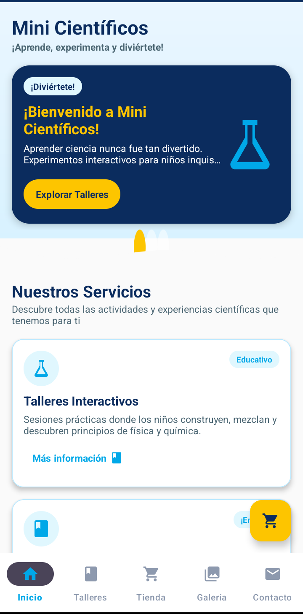
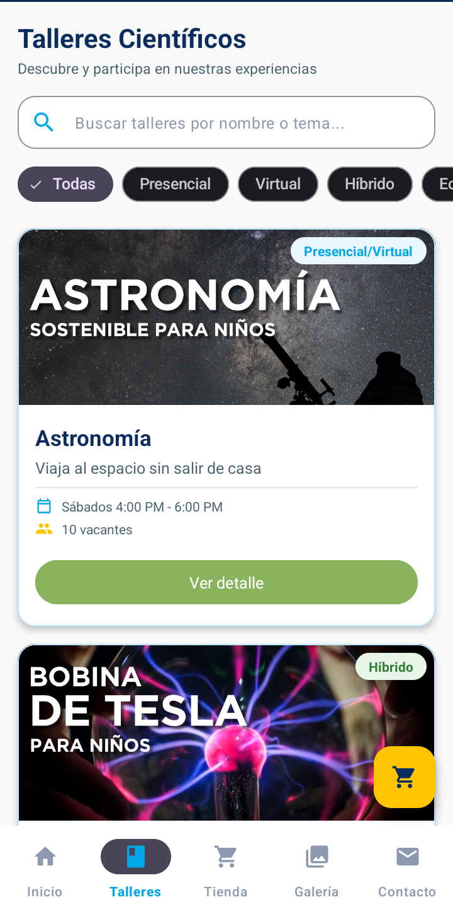
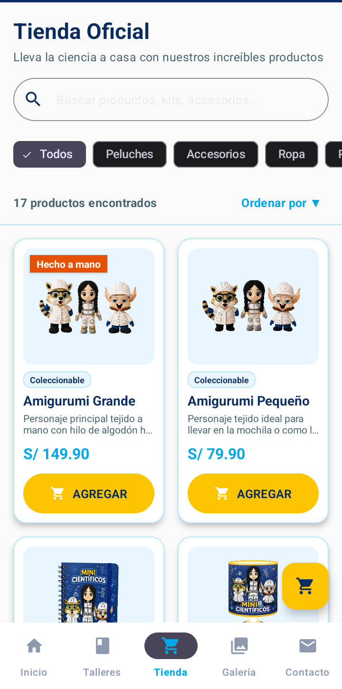
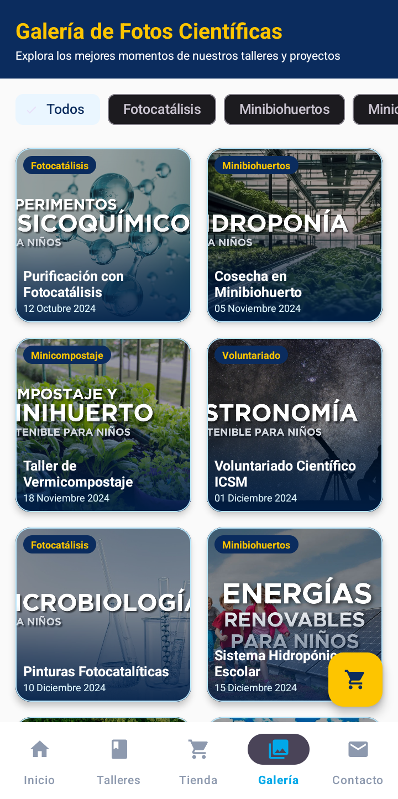
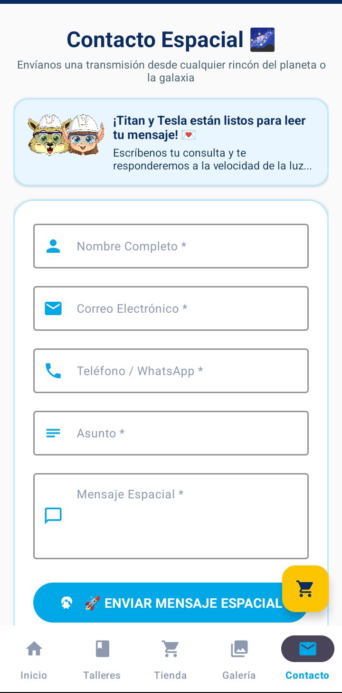

# 🔬 Mini Científicos - App Android

## 📌 Descripción del Proyecto

**Mini Científicos** es una aplicación nativa para Android desarrollada en **Java**, diseñada para trasladar la experiencia de la plataforma web oficial a una interfaz móvil interactiva, colorida y optimizada. Su objetivo es acercar la ciencia a niños, padres de familia y colegios mediante talleres, experimentos en vivo, espectáculos y kits educativos.

El sistema destaca por su enfoque "Kawaii Científico", con componentes visuales adaptados para el público infantil, un e-commerce completamente funcional mediante manejo de estado dinámico y una potente integración con WhatsApp.

---

## 📱 Interfaz de Usuario Principal


| Inicio | Talleres | Tienda | Galería | Contacto |
| :---: | :---: | :---: | :---: | :---: |
|  |  |  |  |  |

---

## 🛍️ Módulos de E-commerce y Detalles (¡NUEVO!)

| Detalle de Taller | Detalle de Producto | Carrito de Compras |
| :---: | :---: | :---: |
|  |  |  |

---

## 🛠️ Tecnologías y Stack Utilizado

* **Lenguaje:** Java 100% (Desarrollo nativo).
* **Diseño UI/UX:** Material Design 3 (M3) adaptado para un público infantil/educativo.
* **Vinculación de Vistas:** `ViewBinding` para un acceso directo, seguro y eficiente a las vistas en XML.
* **Tipografías:** Integración de Google Fonts (`Fredoka`, `Nunito`, `Kalam`) mediante *Downloadable Fonts*.
* **Navegación y Arquitectura:**
  * Patrón Single Activity + Multiple Fragments.
  * `BottomNavigationView` para la conmutación entre las 5 secciones principales.
  * `FragmentContainerView` gestionado dinámicamente desde `MainActivity`.
  * `BottomSheetDialogFragment` implementado para pre-visualizar datos en paneles emergentes interactivos (Detalles y Carrito).
  * Patrón Singleton (`CartManager`) para centralizar y persistir temporalmente el estado del carrito en memoria.
* **Componentes Interactivos:**
  * `ViewPager2` + `TabLayoutMediator` para el carrusel promocional (Hero Slider).
  * `RecyclerView` con adaptadores avanzados (`ListAdapter` / `ViewHolder`), manejando filtrados, notificaciones y callbacks reactivos.
  * `TextWatcher` y `ChipGroup` combinados para búsqueda y filtrado de listas en tiempo real.
  * `FloatingActionButton` (FAB) anclado dinámicamente con actualizaciones asíncronas para el contador (Badge).

---

## 📁 Estructura del Proyecto

El código está organizado de manera limpia y modular (MVC/UI-Driven) en el paquete principal `com.icsm.minicientificos_android`:

```text
app/src/main/java/com/icsm/minicientificos_android/
├── 📂 models/       # Clases POJO (Taller, Producto, CartItem) y Repositorios simulados (CatalogData)
├── 📂 adapters/     # Adaptadores de RecyclerView (TallerAdapter, ProductoAdapter, CartAdapter)
├── 📂 cart/         # Lógica central del E-commerce (CartManager Singleton, interfaces de estado)
├── 📂 utils/        # Herramientas globales (WhatsAppHelper para formatear URIs y pedidos)
├── 📂 ui/           # Fragmentos de vistas, BottomSheets y Helpers (CartBadgeHelper)
└── 📄 MainActivity.java # Host principal que escucha eventos del carrito
```

---

## 🌟 Módulos y Funcionalidades Principales

1. 🏠 **Inicio (Home):**
   * Carrusel promocional dinámico con indicadores circulares (Swiper.js nativo).
   * Vista previa de la oferta de servicios y presentación lúdica de los personajes (**Titan** y **Tesla**).

2. 🧪 **Talleres y Experimentos:**
   * Lista interactiva de talleres educativos con buscador reactivo.
   * Filtros mediante `ChipGroup` (Presencial, Virtual, Híbrido, etc.).
   * **`TallerDetalleBottomSheet`**: Panel modal interactivo con desglose temático, control de vacantes y reserva directa por WhatsApp usando `WhatsAppHelper`.

3. 🛒 **Tienda Científica (E-commerce):**
   * Catálogo de kits y juguetes con imágenes y precios. Búsqueda y filtrado instantáneo en memoria.
   * **`ProductoDetalleBottomSheet`**: Modal que incluye un selector reactivo de cantidades (`[ - 1 + ]`) validado contra el stock disponible.
   * **`CartManager`**: Gestor global del carrito de compras que notifica a la UI sobre cambios.
   * **`CartBottomSheetDialog`**: Pantalla de *Checkout* donde se resumen las compras, se recalculan totales en tiempo real, se eliminan ítems y se procesa el pago a través de un mensaje automatizado de WhatsApp.

4. 🖼️ **Galería:**
   * Cuadrícula fotográfica (`GridLayoutManager`) de eventos reales y actividades escolares.

5. 📞 **Contacto Espacial:**
   * Formulario lúdico con estética "Kawaii Científico" e integración para contrataciones.

---

## 🚀 Cómo Ejecutar el Proyecto

1. **Clonar el repositorio:**
   ```bash
   git clone https://github.com/mrpeak-1/MiniCientificos-Android.git
   ```
2. **Abrir en Android Studio:**
   * Selecciona `Open an Existing Project` y elige la carpeta del proyecto.
3. **Sincronizar Gradle:**
   * Espera a que Android Studio descargue las dependencias y construya el proyecto.
4. **Ejecutar:**
   * Conecta un dispositivo físico o inicia un emulador y presiona **Run** (`Shift + F10`).

---

## 👨‍💻 Desarrollado por

*   **Miguel Córdova**
*   **Mateo Vicente**
*   **Oscar Quille**

<br>

<p align="center">
  <strong>© 2026 MiniCientíficos.</strong>
</p>